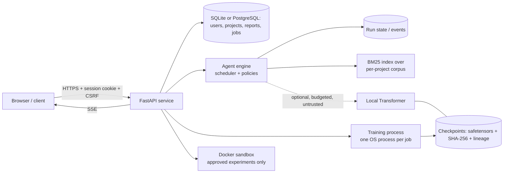

# ResearchOS

[](https://github.com/Adithya-charan/ResearchOS/actions/workflows/ci.yml)


A self-hosted research platform built around **a language model trained from random initialisation in this repository**
and a **custom multi-agent engine**. No pretrained weights, no hosted AI APIs, no Ollama / vLLM / llama.cpp / LangChain.

Reliability does not come from the model. It comes from retrieval, deterministic checks, page-level citations,
sandboxed and reproducible experiments, and human review at every consequential step.

---

## Contents

- [What is in the box](#what-is-in-the-box)
- [Architecture](#architecture)
- [Honest limitations](#honest-limitations)
- [Quick start](#quick-start)
- [HTTP API](#http-api)
- [Security model](#security-model)
- [Deployment (Docker)](#deployment-docker)
- [Configuration](#configuration)
- [Testing and CI](#testing-and-ci)
- [Repository layout](#repository-layout)
- [Roadmap](#roadmap)
- [Contributing, security reports, licence](#contributing-security-reports-licence)

## What is in the box

| Area | What exists (all covered by tests) |
|---|---|
| **Model** | Byte-level BPE tokenizer, decoder-only Transformer (RoPE / RMSNorm / SwiGLU / SDPA options, KV cache), training engine (AdamW, warmup + cosine, grad accumulation, bf16, atomic safetensors checkpoints, **bit-exact resume**, lineage proving descent from random init), sampling runtime with streaming, stop sequences and cancellation |
| **Model Lab (P8)** | Browser UI at `/lab` over real API data: dataset upload with licence + rights confirmation, tokenizer preparation, training runs with live loss, checkpoint verification, evaluation against a random-initialised baseline, streaming inference, a lifecycle registry (INITIALIZED to DEPLOYED, evidence-gated) and an agent-provider switch. See [docs/MODEL_OPERATIONS.md](docs/MODEL_OPERATIONS.md) |
| **Data** | Licence-checked manifests, cleaning, MinHash near-duplicate removal, document-level splits, synthetic CC0 corpus generator |
| **Agents** | Typed contracts, deny-by-default policies, planner, asyncio scheduler (retries, timeouts, limits, pause / cancel, approval gate, crash recovery), SQLite run state, Supervisor / Discovery / Critic and the research workflow agents (Literature, Gap, Hypothesis, Verifier, Synthesis) |
| **Corpus** | PDF / DOCX / TXT / Markdown / HTML ingestion in an isolated subprocess, page-aware passages, quality flags, BM25 search, verifiable citations back to the original page |
| **Reports** | Evidence-linked report (verified findings, unsupported claims, candidate gaps, hypotheses, limitations) with Markdown / PDF / JSON export |
| **Experiments** | Human-approved runs in a Docker sandbox (no network, read-only root, dropped capabilities, resource caps), manifests with hashes, reproduction check, human review, knowledge graph |
| **API** | FastAPI service: accounts and sessions, projects, runs, document upload and search, approvals, experiments, reports, model registry, training jobs, local inference, Server-Sent Events |

## Architecture



Design rules that the code enforces:

* **Retrieval, not recall.** Findings are quoted from indexed documents with a document / page / passage citation. Notes written by
  the local model are labelled untrusted and are never evidence.
* **Nothing is trusted because it was said.** Agent outputs are stored only if they validate against their contract, match
  their task and cite passages that exist. Document text is treated as data, never as instructions.
* **Humans gate consequential actions.** Experiments run only after a human approval bound to the SHA-256 of the exact code.
* **The only novelty claim ever made** is: *"No close match was identified in the indexed corpus searched for this run.
  This is not proof that the idea has never been published."*

## Honest limitations

* The bundled model is a **small experimental LM (~5M parameters)** trained on a **synthetic, template-generated CC0 corpus**.
  It learns the structure and vocabulary of paper-like text, knows no real science, and must never be used as a source of facts.
* Evidence checking is **lexical** (term overlap over BM25 hits). It finds and cites passages; it does not understand them or
  detect contradictions. Every report states that human review is required.
* **The agents are deterministic and extractive.** Since P8 a project owner can opt in to the local Transformer, which then adds one
  short, labelled, untrusted draft note per role (citation-like text is dropped; evidence, citations and verdicts stay deterministic). The
  bundled models reach integration stage 1 at most (structured-output pass rate 0 of 8), no instruction-tuning data or run exists, and
  production mode needs a DEPLOYED model at stage >= 3, so it is not available today.
* **Model quality is not demonstrated.** `small_v1` beats a random-initialised baseline on its own held-out synthetic text (perplexity
  about 1.5) and scores *worse* than that baseline on the seven small out-of-domain probes; about 81 % of its validation 8-grams occur in
  its training text. No public benchmark was run and no comparison with any other model is made.
* The Model Lab's training is an API-supervised subprocess, not the research job queue. The Model Lab UI was exercised in the in-app
  browser and by static/contract tests, not by an automated browser suite.
* Docker sandbox support is implemented but has **not been executed on the development machine** (Docker was unavailable).
  A clearly-labelled non-isolating subprocess fallback exists for development and must not be used for untrusted code.
* No OCR (scanned pages are reported and skipped), no CSV ingestion, malware scanning is a hook only (reported as
  "not configured" unless you supply a scanner).
* Both databases run on SQLite (default) or PostgreSQL (see [docs/DATABASE.md](docs/DATABASE.md); verified against a real PostgreSQL 16 server,
  but the PostgreSQL compose file has not been run end to end because Docker is unavailable here). Rate limiting and SSE gates are still
  in-process, so several API processes multiply those limits. No Redis.
* The website is **not built**; the API is complete enough to drive one.

Per-phase measurements and known limits are recorded in [docs/PHASE_REPORTS.md](docs/PHASE_REPORTS.md).

## Quick start

Requires Python 3.11+. A GPU is optional (CPU training of the tiny config takes about a minute).

```bash
python -m venv .venv
source .venv/bin/activate                       # Windows: .venv\Scripts\Activate.ps1
pip install torch --index-url https://download.pytorch.org/whl/cpu     # or the CUDA build matching your driver
pip install -e ".[dev,api,corpus]"              # installs dependencies only; the repo is an application
```

Build the data and train a model (everything is reproducible from configs and manifests):

```bash
python scripts/hardware_audit.py                         # what fits on this machine
python scripts/make_synthetic_corpus.py --docs 6000      # CC0 corpus + licence manifest
python scripts/prepare_data.py --vocab-size 4096         # verify, clean, dedup, split, train BPE, tokenize
python scripts/train_model.py --config configs/tiny_cpu.yaml     # ~1 minute smoke run (small.yaml for the full demo model)
python scripts/evaluate.py --checkpoint artifacts/checkpoints/tiny_cpu --best
python scripts/generate.py --checkpoint artifacts/checkpoints/tiny_cpu --best --prompt "Title: " --seed 1
```

Run the research workflow over your own documents:

```bash
python scripts/manage_corpus.py ingest ./my_papers --license CC-BY-4.0
python scripts/manage_corpus.py search "ionic conductivity" --year-min 2018
python scripts/run_research.py --library artifacts/corpus --workflow full --report-dir artifacts/reports/run1 \
       --question "How stable are encapsulated cells under damp heat?"
```

Start the API (interactive docs at <http://127.0.0.1:8000/docs>):

```bash
python scripts/serve_api.py
```

Run an approved experiment from the CLI (needs Docker, or add `--allow-weak` for non-isolating local development only):

```bash
python scripts/run_experiment.py run --example --approved-by YOU
```

## HTTP API

Authentication is a server-side session in an HttpOnly cookie. Every state-changing request must carry the per-session
`X-CSRF-Token` header. Objects belonging to other users answer `404`, never `403`.

| Group | Endpoints (summary) |
|---|---|
| Auth | `POST /auth/register`, `/auth/login`, `/auth/logout`, `GET /auth/me` |
| Projects & runs | `/projects`, `/projects/{id}/runs`, `/runs/{id}` (`start`, `pause`, `resume`, `cancel`, `tasks`, `events`, `report`) |
| Corpus | `/projects/{id}/documents` (upload, list, passages, reprocess, delete), `/projects/{id}/search` |
| Approvals | `GET /approvals`, `POST /approvals/{kind}/{id}/approve \| reject` |
| Experiments | `/projects/{id}/experiments`, `/experiments/{id}` (`spec`, `request-approval`, `execute`, `logs`, `artifacts`, `reproduce`, `review`) |
| Reports | `POST /runs/{id}/reports`, `GET/PATCH /reports/{id}`, `/versions`, `/export.md`, `/export.pdf`, `/export.json`, `/structured`, `/structured.md` |
| Claims and evidence | `POST/GET /projects/{id}/claims`, `/claims/{cid}`, `/claims/{cid}/evidence`, `/claims/{cid}/verify`, `/claims/{cid}/verifications`, `/projects/{id}/verifications`, `POST /runs/{id}/claims/extract`, `/projects/{id}/novelty` (see `docs/EVIDENCE_VERIFICATION.md`) |
| Models | `/models`, `/models/{id}` (`checkpoints`, `health`, `generate`, `generate/stream`), `/training/jobs` (`pause`, `resume`, `cancel`, `metrics`, `samples`, `log`) |
| Live events (SSE) | `/runs/{id}/stream`, `/training/jobs/{id}/stream`, `/experiments/{id}/stream`; reconnect with `Last-Event-ID` |

## Security model

| Concern | Control |
|---|---|
| Passwords & sessions | Argon2id; only a hash of the session token is stored; HttpOnly + SameSite=Lax cookie; expiry re-checked on live streams |
| CSRF / origin | Per-session CSRF token on every unsafe method; origin allow-list |
| Authorisation | Every object lookup is scoped to its owner; cross-user access is indistinguishable from "not found" |
| Abuse | Sliding-window rate limits (login, registration, generation), per-user quotas, upload size and count limits, stream caps |
| Uploads | Safe file names, content validation, extraction in an isolated subprocess, prompt-injection screening, pluggable malware-scanner hook |
| Code execution | Only after human approval bound to the code hash; Docker sandbox with no network, read-only root, dropped capabilities, resource caps; model-generated code never runs outside a container |
| Artifacts | Served only if listed in the manifest, confined to the output folder, hash-verified, never rendered by the browser |
| Integrity | Checkpoints and reports are hash-stamped; tampering is detected and refused rather than served |
| Streams | SSE frames are built from JSON only, so untrusted text cannot add fields or events |

See [SECURITY.md](SECURITY.md) to report a vulnerability.

## Deployment (Docker)

```bash
docker compose up --build            # API on http://127.0.0.1:8000, state in the `researchos-data` volume
docker compose logs -f api
```

* Runs as an unprivileged user with a read-only root filesystem, all Linux capabilities dropped and `no-new-privileges`.
* The port is bound to loopback. Put a TLS reverse proxy in front, then set `RESEARCHOS_COOKIE_SECURE=true`,
  `RESEARCHOS_ALLOWED_ORIGINS` and `RESEARCHOS_TRUSTED_PROXIES` (the proxy's address) so rate limiting sees real client IPs.
* Operator checkpoints are mounted read-only from `./artifacts/checkpoints` (override with `RESEARCHOS_MODELS_PATH`).
* The default compose file is the single-host SQLite setup (no Redis anywhere). **The Docker socket is deliberately not
  mounted**, so inside the container experiments are refused unless you set the non-isolating development fallback.
* CI builds and runs the image; it has not been built on the author's machine (no Docker there).

### Production (P10)

```bash
cp .env.example .env     # set POSTGRES_PASSWORD and RESEARCHOS_ALLOWED_ORIGINS
docker compose -f docker-compose.prod.yml --env-file .env up -d --build
```

PostgreSQL (internal network only) + one-shot migration + API serving the web app + worker, one multi-stage image that builds the frontend. **Not yet
verified on a Docker host**; see [docs/DOCKER.md](docs/DOCKER.md) for the checklist, [docs/DEPLOYMENT.md](docs/DEPLOYMENT.md) (environment variables,
TLS proxy, checklist), [docs/SECURITY.md](docs/SECURITY.md) (review, rate limits, headers, dependency audit, PyMuPDF licence question),
[docs/CI_CD.md](docs/CI_CD.md), [docs/PERFORMANCE.md](docs/PERFORMANCE.md) and [docs/BACKUP_RECOVERY.md](docs/BACKUP_RECOVERY.md).

### PostgreSQL deployment

```bash
cp .env.example .env     # set POSTGRES_PASSWORD (no default exists; use URL-safe characters)
docker compose -f docker-compose.yml -f docker-compose.postgres.yml up --build
```

Adds `postgres` (persistent volume, health check, no published port), a one-shot `migrate` service, `api` and a separate `worker`.
Both databases live in one PostgreSQL database in two schemas (`api`, `engine`). To move an existing SQLite installation, stop the app and run
`python scripts/migrate_database.py --to "$RESEARCHOS_DATABASE_URL" --api-db artifacts/api/researchos.db --engine-db artifacts/api/engine.db`
(refuses a non-empty target, never alters the source). Without Docker: `pip install -e ".[postgres]"`, set `RESEARCHOS_DATABASE_URL=postgresql://…`,
run `python scripts/migrate_db.py upgrade`, then the API and `python scripts/run_worker.py`.

## Configuration

All settings are environment variables prefixed `RESEARCHOS_` (see [`api/config.py`](api/config.py) and [`.env.example`](.env.example)).

| Variable | Default | Purpose |
|---|---|---|
| `RESEARCHOS_DATABASE_URL` | local SQLite | API database; a `postgresql://` URL switches both databases to PostgreSQL (schemas `api` / `engine`) |
| `RESEARCHOS_ENGINE_DATABASE_URL`, `RESEARCHOS_DATABASE_SCHEMA`, `RESEARCHOS_ENGINE_DATABASE_SCHEMA`, `RESEARCHOS_DB_POOL_SIZE`, `RESEARCHOS_DB_MAX_OVERFLOW` | see docs | PostgreSQL only: engine location, schema names, API pool |
| `RESEARCHOS_DATA_DIR` | `artifacts/api/data` | per-project libraries, experiment runs, training jobs |
| `RESEARCHOS_ALLOWED_ORIGINS` | `localhost:3000` | browser origins allowed to make unsafe requests |
| `RESEARCHOS_COOKIE_SECURE` | `false` | set `true` behind TLS |
| `RESEARCHOS_AUTO_MIGRATE` | `true` | apply Alembic migrations at startup; `false` = refuse to start unless the schema is at head |
| `RESEARCHOS_EMBEDDED_WORKER` | `true` | run a research worker thread inside the API process; `false` = jobs wait for `python scripts/run_worker.py` (one or more separate processes) |
| `RESEARCHOS_TRAINING_ENABLED` | `false` | let users start training jobs (uses host CPU/GPU) |
| `RESEARCHOS_ADMIN_EMAILS` | empty | comma-separated accounts that may DEPLOY a model or change system models' lifecycle; empty = nobody can |
| `RESEARCHOS_MODELS_DIR` | `artifacts/checkpoints` | operator checkpoints shown in the model registry |
| `RESEARCHOS_INFERENCE_DEVICE` | `cpu` | device for local generation |
| `RESEARCHOS_ALLOW_WEAK_SANDBOX` | `false` | permit the **non-isolating** fallback when Docker is unavailable (development only) |
| `RESEARCHOS_TRUSTED_PROXIES` | `127.0.0.1` | addresses whose `X-Forwarded-For` is trusted |
| `RESEARCHOS_DEMO_CORPUS` | `false` | let projects without documents search the synthetic demo corpus |

## Web app (P9)

A React + TypeScript single-page app lives in `frontend/` and is served by the API at `/app` (same origin, strict CSP). Build and open it:

```bash
cd frontend && npm ci && npm run build
# then start the API as usual and browse to http://127.0.0.1:8000/app
```

Overview, projects, research workspace, agent command center, literature library (lexical search, not semantic), evidence verification, reports,
and more. It uses only existing endpoints plus read-only `/overview` and `/audit`. Design and testing notes: `docs/UI_DESIGN_SYSTEM.md`,
`docs/FRONTEND_ARCHITECTURE.md`, `docs/FRONTEND_API_INTEGRATION.md`, `docs/FRONTEND_TESTING.md`. Limits: no password change, gaps/hypotheses are
derived from agent output, Model Lab is read-only; the Dockerfile does not build the frontend yet.

## Model Lab (P8)

Start the API and open `http://127.0.0.1:8000/lab`; sign in with an API account. Set `RESEARCHOS_TRAINING_ENABLED=true` to allow training
from the UI and `RESEARCHOS_ADMIN_EMAILS` to name who may deploy. Same-origin writes from `/lab` work without extra origin settings.
Measure your own hardware with `python scripts/bench_model.py` (writes `artifacts/evaluation/model_hardware.json`, shown in the lab).
Details: [docs/CUSTOM_MODEL_ARCHITECTURE.md](docs/CUSTOM_MODEL_ARCHITECTURE.md), [TOKENIZER](docs/TOKENIZER.md),
[TRAINING_PIPELINE](docs/TRAINING_PIPELINE.md), [INFERENCE_ENGINE](docs/INFERENCE_ENGINE.md), [MODEL_EVALUATION](docs/MODEL_EVALUATION.md),
[MODEL_OPERATIONS](docs/MODEL_OPERATIONS.md).

## Testing and CI

```bash
python -m pytest                 # full suite (~4 minutes on CPU)
python -m pytest tests/test_api_reports.py
```

The suite covers the model and training pipeline (including bit-exact resume), the agent engine and its failure modes, corpus
ingestion, experiments, and the HTTP API with security-focused tests (user isolation, CSRF, origin checks, rate limits,
path traversal, tamper detection, approval-bound execution). GitHub Actions runs it on every push and pull request.

## Repository layout

| Path | Contents |
|---|---|
| `model/` | tokenizer, architecture, data pipeline, training, inference, evaluation |
| `agent_engine/` | contracts, scheduler, planner, policies, state, memory, agents, reporting |
| `research/` | BM25 index, document corpus, experiments + sandbox, knowledge graph, formal-check hook |
| `api/` | FastAPI app, models, services, routes, SSE |
| `scripts/` | CLI entry points |
| `configs/` | training configurations (`tiny_cpu`, `cpu_debug`, `small`, `consumer_medium`; the last three match the hardware profiles) |
| `datasets/manifests/` | committed licence manifests (raw and processed data are git-ignored) |
| `docs/` | measured per-phase results and known limits |
| `tests/` | pytest suite |

## Roadmap

Done: model pipeline, agent engine, corpus, research workflow, experiments, the API (auth, projects, runs, corpus,
approvals, experiments, reports, models, SSE), Docker packaging and Alembic migrations.

Next: PostgreSQL + Redis, the Next.js website, OCR and CSV ingestion,
instruction-tuning data and a measured stage-3 evaluation for the local model, single-task retry, SymPy / Z3 checks, a real licensed training corpus
(your decision), gVisor / Firecracker evaluation.

## Contributing, security reports, licence

* Contributions: see [CONTRIBUTING.md](CONTRIBUTING.md). Please keep the project's honesty rules: never present unfinished
  work as complete and never weaken a limitation notice.
* Vulnerabilities: see [SECURITY.md](SECURITY.md).
* **Licence: not yet chosen.** Until a `LICENSE` file is added, all rights are reserved by the author. Note that the optional
  PDF extractor (PyMuPDF) is AGPL-3.0, which matters if you distribute or host this software.
